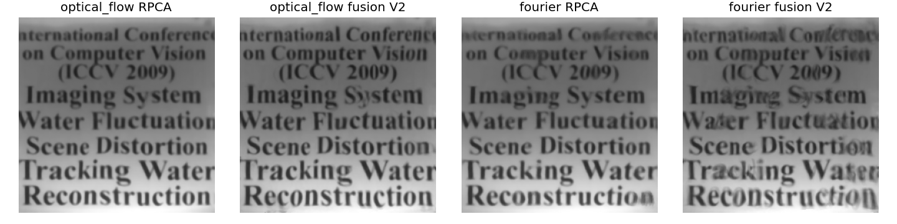

# Un-Rippling: Recovering Scenes Seen Through Wavy Water Without Deep Learning

A classical Digital Image Processing course project on recovering a stationary scene through moving water. The five stages compare temporal aggregation, iterative optical flow, robust PCA, lucky patch fusion and an alternative sparse Fourier registration.

**[Open the self-contained course submission](final/README.md)** · [Project report](final/docs/project_report.pdf) · [Experimental results](final/docs/experiments.md)

Run from `final/`. Create and activate a Python virtual environment, install the CPU dependencies described in the submission README, then run `python -m pytest -q`. The submission includes the downloader and compact measured results. Historical development code, scripts, the baseline notebook and the original tuning log are preserved in the old/ directory. [Historical pipeline log](old/pipeline.md)
