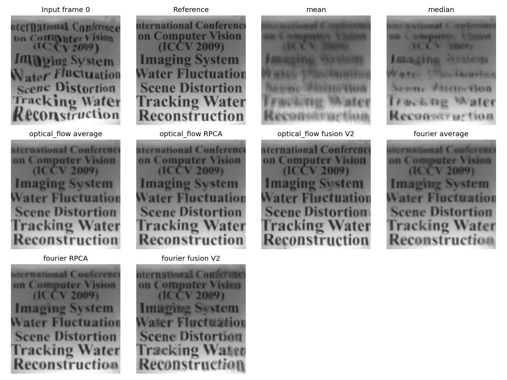
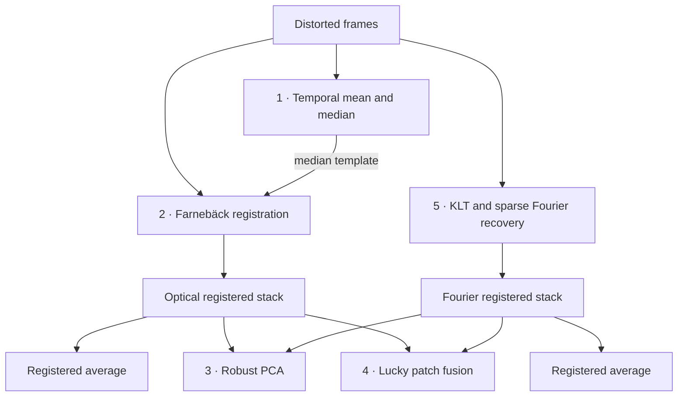
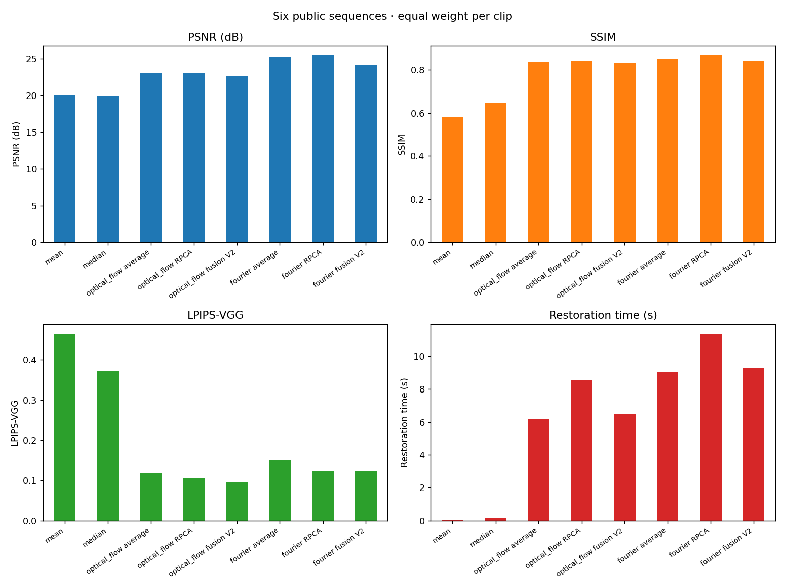

# Un-Rippling: Recovering Scenes Seen Through Wavy Water Without Deep Learning

**Digital Image Processing course project.** A moving water surface bends the same text or edge differently in each video frame. Temporal averaging suppresses the motion but blurs detail. We compare two ways of estimating the distortion and two ways of combining the aligned observations. Every reconstruction uses classical image processing. A pretrained VGG network scores completed images through LPIPS.



[Course report (PDF)](docs/project_report.pdf) · [Editable report](docs/project_report.md) · [Results and image gallery](docs/experiments.md)

## How the five stages fit together



1. **Mean and median** establish the two temporal baselines. The median initializes optical registration.
2. **Farnebäck registration** repeatedly estimates dense flow to original frames and averages valid warped samples into a better template.
3. **Robust PCA** splits a registered stack into low-rank scene structure and sparse discrepancies. The mean low-rank image is the output.
4. **Lucky patch fusion** is our adaptation of lucky-region selection. It scores overlapping registered patches by sharpness (V1), template similarity (V2 adds NCC) and motion confidence (V3). Selected patches blend with a smooth Hann window.
5. **Sparse Fourier registration** is the alternative to Stage 2. Tracked KLT points constrain a 3D Fourier motion field recovered by FISTA. Residual polynomial flow is a separate optional experiment.

The four primary outputs are optical RPCA, optical fusion, Fourier RPCA and Fourier fusion. RPCA and fusion independently use the same registered frames on each branch. Adding two temporal baselines and the two branch averages gives eight methods. V2 is the prespecified primary fusion setting.

## Results

Six public source videos cover five captured clips (Checker, Middle, Cartoon, Eye and Small) and one authors’ simulated clip (Vision). They supply 606 original frames; the first 100 of each gave 600 unique public input frames. Four scaled distortions of one clean cameraman image add 80 generated frame instances. They share one seed and motion realization and are four conditions, not four independent scenes. Across ten cases the release contains 40 primary images and 40 baseline images. It also includes 39 additional V1/V3 images and 18 refined reconstructions, for **137 scored image outputs**. Figures, PNG/float copies, earlier trials and smoke tests are excluded from this count. The two primary branches produced 1,360 registered frame instances; six additional final refined stacks contributed 600. Intermediate arrays can be regenerated locally.

Mean across the six public sequences, each receiving equal weight:

| Method | PSNR (dB) ↑ | SSIM ↑ | LPIPS ↓ | Time (s) ↓ |
| --- | --- | --- | --- | --- |
| mean | 20.0376 | 0.5835 | 0.4647 | 0.0049 |
| median | 19.8185 | 0.6472 | 0.3722 | 0.1302 |
| Farnebäck average | 23.0641 | 0.8365 | 0.1178 | 6.2128 |
| Farnebäck RPCA | 23.0359 | 0.8406 | 0.1051 | 8.5536 |
| Farnebäck fusion V2 | 22.6007 | 0.8320 | 0.0941 | 6.4704 |
| Fourier average | 25.1787 | 0.8501 | 0.1493 | 9.0569 |
| Fourier RPCA | 25.4529 | 0.8672 | 0.1223 | 11.3792 |
| Fourier fusion V2 | 24.1833 | 0.8422 | 0.1227 | 9.3009 |

Fourier RPCA had the highest mean PSNR and SSIM and led PSNR on five of six videos. Farnebäck V2 fusion had the lowest mean LPIPS among the eight methods. V3 lowered LPIPS against V2 in all 12 public branch–clip pairs, with PSNR gains in 10. It is a useful option when confidence exists. V2 also works on refined fields and when too few tracks survive. Refinement improved PSNR for all 18 tested Fourier outputs. At extreme generated distortion Fourier V2 fell below the mean, with just six usable tracks.



[All per-clip metrics](comparison/results/course/combined.csv) · [Fusion ablations](comparison/results/course/fusion_ablation.csv) · [Refinement](comparison/results/course/refinement.csv) · [Distortion study](comparison/results/course/distortion_levels.png)

## Running the submission

From a repository checkout, enter `final/`. Use Python 3.10+ and create the environment with `python -m venv .venv`. Activate using `source .venv/bin/activate` on Linux or `.\.venv\Scripts\Activate.ps1` in Windows PowerShell. Run these commands in the activated environment:

```sh
python -m pip install torch torchvision --index-url https://download.pytorch.org/whl/cpu
python -m pip install -r requirements.txt
python -m pip install -e .
python data/download_data.py --datasets checker middle cartoon eye small vision
python -m pytest -q
python main.py --dataset checker --method all --frames 100 --size 256 --save-stack
python -m comparison.batch --refine
python -m comparison.course
```

The batch command reproduces the six public clips, all four generated conditions and six refined stacks under new run IDs. The last command regenerates the shipped summary. LPIPS downloads VGG weights on first use. For timing comparisons set OPENBLAS_NUM_THREADS and OMP_NUM_THREADS to 2. For fast standalone debugging:

```sh
python -m stage_1.run_stage_1 --dataset synthetic --frames 8 --size 80 --amplitude 1 --no-lpips
python -m stage_2.run_stage_2 --dataset synthetic --frames 8 --size 80 --amplitude 1 --save-stack --no-lpips
python -m stage_3.run_stage_3 --dataset synthetic --frames 8 --size 80 --amplitude 1 --no-lpips
python -m stage_4.run_stage_4 --dataset synthetic --frames 8 --size 80 --amplitude 1 --no-lpips
python -m stage_5.run_stage_5 --dataset synthetic --frames 8 --size 80 --amplitude 1 --save-stack --no-lpips
python -m comparison.compare comparison/results/checker/9d47ebe6af67
```

Stages 3 and 4 accept `--branch fourier` or `--branch optical_flow` and `--registered PATH` pointing at the corresponding saved Stage 5 or 2 run. Match the source, frame count and dimensions. Input fingerprints are checked before reusing a stack. Data directories and all 14 supported public sequence names are listed in [data/README.md](data/README.md) and the [dataset inventory](docs/dataset_inventory.md).

## Submission structure

| Directory | Contents |
|---|---|
| stage_1/ … stage_5/ | Each has the algorithm, run_stage_N.py, test_stage_N.py and results/. Stage-local outputs include reconstructed images, timing, metrics and diagnostics. |
| utils/, main.py | Shared I/O, metrics, synthetic data, visualization and the orchestration CLI |
| data/ | Pinned downloader, manifest and local real/public-synthetic/generated inputs |
| comparison/ | Single-run plots, batch execution, combined tables and both four- and eight-method montages |
| docs/ | Report, mathematical derivation, audit, dataset and experiment records, test receipts and complete tree |
| requirements.txt, pyproject.toml | Dependencies, install and test configuration |

[Complete file tree](docs/repository_tree.txt) · [Pipeline mathematics and references](docs/pipeline.md) · [Cross-branch audit](docs/branch_comparison.md) · [Tests](docs/test_summary.txt)

James et al. provide the trajectory/Fourier model and paired dataset. Farnebäck supplies the local polynomial registration model; principal component pursuit and IALM supply the low-rank baseline. Our course comparison adapts these methods and patch selection to a common registered-stack interface. The public sample is small, the generated levels share one scene, and the official MFIR benchmark remains unevaluated by the five-stage submission. [Original proposal and bibliography](docs/proposal.pdf) · [James et al., ICCV 2019](https://openaccess.thecvf.com/content_ICCV_2019/html/James_Restoration_of_Non-Rigidly_Distorted_Underwater_Images_Using_a_Combination_of_ICCV_2019_paper.html)
