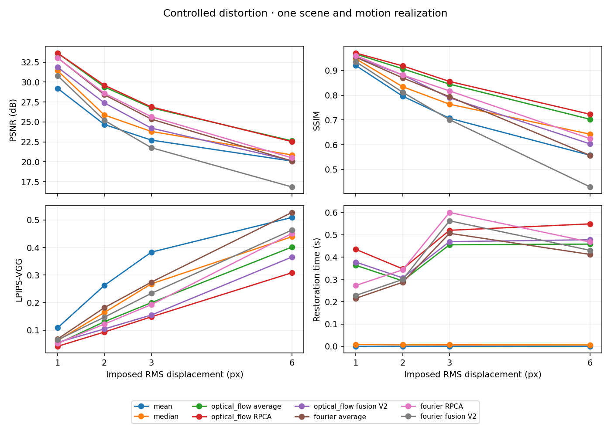

# Final course evaluation

Six public source videos cover five captured clips (Checker, Middle, Cartoon, Eye and Small) and one authors’ simulated clip (Vision). They supply 606 original frames; the first 100 of each gave 600 unique public input frames. Four scaled distortions of one clean cameraman image add 80 generated frame instances. They share one seed and motion realization and are four conditions, not four independent scenes. Across ten cases the release contains 40 primary images and 40 baseline images. It also includes 39 additional V1/V3 images and 18 refined reconstructions, for **137 scored image outputs**. Figures, PNG/float copies, earlier trials and smoke tests are excluded from this count. The two primary branches produced 1,360 registered frame instances; six additional final refined stacks contributed 600. Intermediate arrays can be regenerated locally.

## Public videos

Each clip has equal weight. PSNR and SSIM use unit-range floating-point grayscale reconstructions; LPIPS-VGG receives the same four-pixel interior crop in three replicated channels. Time includes registration once for a downstream output and excludes decoding, file I/O, charts and metric evaluation. The public experiment uses the first 100 frames, center-square resize to 256 × 256, two frame workers, CPU VGG and two BLAS/OpenMP threads. Wall-clock times are single-run observations on an AMD EPYC 9V74 cloud host with a two-vCPU quota. Earlier Checker/Middle wall times including all plots, metrics and I/O are retained below. Concurrent host activity can influence timings.

| Method | PSNR (dB) ↑ | SSIM ↑ | LPIPS ↓ | Time (s) ↓ |
| --- | --- | --- | --- | --- |
| mean | 20.0376 | 0.5835 | 0.4647 | 0.0049 |
| median | 19.8185 | 0.6472 | 0.3722 | 0.1302 |
| Farnebäck average | 23.0641 | 0.8365 | 0.1178 | 6.2128 |
| Farnebäck RPCA | 23.0359 | 0.8406 | 0.1051 | 8.5536 |
| Farnebäck fusion V2 | 22.6007 | 0.8320 | 0.0941 | 6.4704 |
| Fourier average | 25.1787 | 0.8501 | 0.1493 | 9.0569 |
| Fourier RPCA | 25.4529 | 0.8672 | 0.1223 | 11.3792 |
| Fourier fusion V2 | 24.1833 | 0.8422 | 0.1227 | 9.3009 |

### PSNR by video

| Method | Cartoon | Checker | Eye | Middle | Small | Vision |
| --- | --- | --- | --- | --- | --- | --- |
| Fourier RPCA | 28.9790 | 23.8101 | 31.0626 | 25.2432 | 26.4108 | 17.2115 |
| Fourier average | 28.8992 | 23.4291 | 30.8358 | 24.4203 | 26.2203 | 17.2677 |
| Fourier fusion V2 | 28.0750 | 22.2125 | 29.3423 | 23.1198 | 25.5526 | 16.7976 |
| mean | 23.5033 | 16.5029 | 22.3482 | 19.2113 | 22.1098 | 16.5499 |
| median | 23.1376 | 16.9738 | 22.3432 | 18.7589 | 22.1963 | 15.5011 |
| Farnebäck RPCA | 23.8037 | 18.6081 | 27.1395 | 22.5378 | 26.1769 | 19.9498 |
| Farnebäck average | 24.0359 | 18.6537 | 27.1826 | 22.6752 | 26.1360 | 19.7010 |
| Farnebäck fusion V2 | 22.8220 | 18.4184 | 26.6594 | 22.0135 | 25.6523 | 20.0388 |

Fourier RPCA leads the eight prespecified methods in PSNR on five videos. On Vision, Farnebäck fusion V2 reaches 20.04 dB while Fourier RPCA reaches 17.21 dB. Thus the two initial clips overstate how reliably the Fourier branch leads. Equal-weight LPIPS favors Farnebäck fusion V2. Its average PSNR is lower than the Farnebäck average.

## Fusion ablation

| Method | PSNR (dB) ↑ | SSIM ↑ | LPIPS ↓ | Time (s) ↓ |
| --- | --- | --- | --- | --- |
| Farnebäck fusion V1 | 22.5476 | 0.8285 | 0.0971 | 6.4594 |
| Farnebäck fusion V2 | 22.6007 | 0.8320 | 0.0941 | 6.4704 |
| Farnebäck fusion V3 | 22.6171 | 0.8339 | 0.0921 | 6.4995 |
| Fourier fusion V1 | 23.6687 | 0.8242 | 0.1364 | 9.2993 |
| Fourier fusion V2 | 24.1833 | 0.8422 | 0.1227 | 9.3009 |
| Fourier fusion V3 | 24.4301 | 0.8487 | 0.1165 | 9.3613 |

V3 beats V2 in LPIPS on all 12 public branch–clip pairs, in PSNR on 10/12 and in SSIM on 11/12. The exceptions in PSNR are Eye with optical flow and Cartoon with Fourier registration. V3 is a reasonable development choice when confidence is available and perceptual similarity is the priority. Keep V2 as the reproducible course comparison default: it applies to both unrefined and refined stacks and to clips with sparse support. All V2 and V3 scores come from the same per-branch stack. Refined Fourier lacks an independently estimated confidence map.

## Polynomial refinement

| Method | PSNR (dB) ↑ | SSIM ↑ | LPIPS ↓ | Time (s) ↓ |
| --- | --- | --- | --- | --- |
| Fourier average | 26.1929 | 0.8966 | 0.0953 | 5.6081 |
| Fourier RPCA | 26.3005 | 0.9038 | 0.0863 | 7.8787 |
| Fourier fusion V2 | 25.7118 | 0.8965 | 0.0807 | 5.8739 |

These runs apply the same residual polynomial-flow option to all six public inputs. Against the corresponding unrefined Fourier result, PSNR increases for all 18 pairs and LPIPS decreases for all 18. The RPCA SSIM on Checker falls slightly. Refined V2 gains 2.81 dB on Middle and 1.37 dB on Vision. The unrefined timed registration includes split-track fits for V3; refined timing omits those fits. Comparing their total seconds does not isolate the cost of the refinement itself. [Individual refinement scores](../comparison/results/course/refinement.csv)

## Controlled distortion

The labels low, medium, high and extreme correspond to 1, 2, 3 and 6 px RMS. Each clip uses 20 frames at 128 square, NumPy seed 0, independent Gaussian fields smoothed at sigma 8 px, temporal mean removed, scaled to the target RMS. Frames sample the clean cameraman image at grid plus the imposed displacement. These labels are internal and have no calibration to MFIR amplitudes.

| method | 1 px | 2 px | 3 px | 6 px |
| --- | --- | --- | --- | --- |
| Fourier RPCA | 33.0369 | 28.5971 | 25.6681 | 20.4997 |
| Fourier average | 33.0605 | 28.4203 | 25.3567 | 20.1049 |
| Fourier fusion V2 | 30.8163 | 25.1985 | 21.7763 | 16.8538 |
| mean | 29.2203 | 24.6824 | 22.7302 | 20.0948 |
| median | 31.4400 | 25.8719 | 23.8148 | 20.8689 |
| Farnebäck RPCA | 33.6469 | 29.6072 | 26.8860 | 22.5442 |
| Farnebäck average | 33.6421 | 29.3974 | 26.7822 | 22.6355 |
| Farnebäck fusion V2 | 31.8604 | 27.3928 | 24.2309 | 20.1403 |



At 6 px only six tracks survive. Both Fourier coordinates reach the 500-iteration cap and the stationarity residuals exceed 1e−4. Fourier V3 is unavailable because fewer than eight tracks cannot form two usable halves. V2 Fourier fusion falls to 16.85 dB, below the temporal mean at 20.09 dB. All eight primary rows remain available. The full CSV includes every observed PSNR, SSIM, VGG LPIPS and time. [All measurements](../comparison/results/course/combined.csv)

## Visual comparison index

| Case | Artifacts |
|---|---|
| checker | [Four primary](../comparison/results/checker/9d47ebe6af67/primary.png) · [Eight + input + reference](../comparison/results/checker/9d47ebe6af67/comparison.png) · [Scores](../comparison/results/checker/9d47ebe6af67/metrics.csv) |
| middle | [Four primary](../comparison/results/middle/4d86b0ef1cba/primary.png) · [Eight + input + reference](../comparison/results/middle/4d86b0ef1cba/comparison.png) · [Scores](../comparison/results/middle/4d86b0ef1cba/metrics.csv) |
| cartoon | [Four primary](../comparison/results/cartoon/d19edd5500e2/primary.png) · [Eight + input + reference](../comparison/results/cartoon/d19edd5500e2/comparison.png) · [Scores](../comparison/results/cartoon/d19edd5500e2/metrics.csv) |
| eye | [Four primary](../comparison/results/eye/c67ef1ce34c2/primary.png) · [Eight + input + reference](../comparison/results/eye/c67ef1ce34c2/comparison.png) · [Scores](../comparison/results/eye/c67ef1ce34c2/metrics.csv) |
| small | [Four primary](../comparison/results/small/dd2b22e9b936/primary.png) · [Eight + input + reference](../comparison/results/small/dd2b22e9b936/comparison.png) · [Scores](../comparison/results/small/dd2b22e9b936/metrics.csv) |
| vision | [Four primary](../comparison/results/vision/8eb4243fe361/primary.png) · [Eight + input + reference](../comparison/results/vision/8eb4243fe361/comparison.png) · [Scores](../comparison/results/vision/8eb4243fe361/metrics.csv) |
| Generated 1 px | [Four primary](../comparison/results/synthetic/792626a1c579/primary.png) · [Eight + input + reference](../comparison/results/synthetic/792626a1c579/comparison.png) · [Scores](../comparison/results/synthetic/792626a1c579/metrics.csv) |
| Generated 2 px | [Four primary](../comparison/results/synthetic/33b1a1c9615a/primary.png) · [Eight + input + reference](../comparison/results/synthetic/33b1a1c9615a/comparison.png) · [Scores](../comparison/results/synthetic/33b1a1c9615a/metrics.csv) |
| Generated 3 px | [Four primary](../comparison/results/synthetic/1c1acb66ab93/primary.png) · [Eight + input + reference](../comparison/results/synthetic/1c1acb66ab93/comparison.png) · [Scores](../comparison/results/synthetic/1c1acb66ab93/metrics.csv) |
| Generated 6 px | [Four primary](../comparison/results/synthetic/fd3914b6f5e1/primary.png) · [Eight + input + reference](../comparison/results/synthetic/fd3914b6f5e1/comparison.png) · [Scores](../comparison/results/synthetic/fd3914b6f5e1/metrics.csv) |

## Provenance and reproduction

The five published comparisons from the earlier cloud work (Checker, Middle and generated 1/3/6 px) retain their original scores. Four additional public runs and the 2 px run complete the ten-case table. Eighteen refined results were measured using six shared refined registrations. The earlier two refinement-only average rows remain in the historical section. The new course measurements ran on the a05cf67 implementation with dataset/CLI extensions; branch 792549e moved those algorithms into final/. No score-changing implementation was substituted. Independent replay and isolated tests check the reorganized implementation. The final diagnostic additions are outside the restoration calculation. No teammate sweep rows were reused. [Run manifest](../comparison/results/course/runs.json) · [Branch audit](branch_comparison.md)

From final/, run the six-clip downloader command in the README, then `python -m comparison.batch --refine`. This creates fresh run IDs and a separate manifest. Use `python -m comparison.course` to rebuild the combined tables from the shipped manifest. The eight unevaluated public clips have pinned entries. To extend the same comparison:

```sh
python data/download_data.py --datasets bluetiles brickwall bricks dices elephant handwritten math tiny
python -m comparison.batch --datasets bluetiles brickwall bricks dices elephant handwritten math tiny --amplitudes
```

# Historical cloud experiments on Checker and Middle


## Development protocol

Both captured clips used the first 100 of 101 frames and the same center-square resize to 256 × 256. Metrics use the inner 248 × 248 floating-point grayscale image. VGG-LPIPS receives three replicated channels in [−1,1]. No optimizer or selector reads the supplied reference. The main fusion row uses V2, fixed before comparing the variants. Both sources are development examples. No final-test or unseen-water samples entered parameter selection. Source attribution, native dimensions and transfer bytes are in [data/README.md](../data/README.md).

Real1 has a still-water reference. The Real2 paper and source provide a matching text reference. At working resolution the zero-shift median/reference correlations were 0.875 and 0.833. A diagnostic ±10-pixel search with quarter-pixel refinement (16-pixel interior) favored moving the median by (+0.75,+1.00) pixels for Checker and (0,+0.50) for Middle. The optical/Fourier average diagnostics favored (+0.50,+1.00)/(−0.25,+0.25) on Checker and (+0.25,+0.50) for both on Middle. This method dependence on Checker is consistent with template bias. Both montages show the same scene and ordering. All reported methods use the unshifted references. Small score differences can be sensitive to residual alignment. No perfectly registered clean coordinate system has been independently measured.

Hardware was an AMD EPYC 9V74 cloud host with a two-vCPU quota, 8 GiB cgroup memory and about 7.5 GiB available disk at startup. CPU only, two BLAS/OpenMP threads, one OpenCV thread and two frame workers. Python 3.12.14, NumPy 2.3.5, SciPy 1.17.0, OpenCV headless 5.1.0.95, scikit-image 0.26.0, torch 2.15.0+cpu, torchvision 0.29.2+cpu and lpips 0.1.4. The first evaluation downloaded standard ImageNet VGG16 weights; weights were cached for the measured runs.

Stage seconds time reconstruction on decoded arrays. Total seconds add the shared registration once to each downstream method. Registration includes confidence diagnostics. The full-process time additionally includes imports, decoding, metric evaluation, image/array I/O, ablations and comparison figures. Stage times exclude those operations. RPCA invalid samples receive the final registration reference. No sharpening or polynomial refinement is used in the main comparison.

## Checker

Run `9d47ebe6af67` took 38.03 s wall time and peaked at 1524 MiB RSS for the full process. Per-image scores and stage timings follow. [Comparison image](../comparison/results/checker/9d47ebe6af67/comparison.png) · [Full-precision CSV](../comparison/results/checker/9d47ebe6af67/metrics.csv) · [Configuration](../comparison/results/checker/9d47ebe6af67/config.json)

| Method | PSNR (dB) | SSIM | LPIPS ↓ | Stage (s) | Total (s) |
|---|---|---|---|---|---|
| mean | 16.5029 | 0.5792 | 0.5466 | 0.0040 | 0.0040 |
| median | 16.9738 | 0.7403 | 0.4005 | 0.1435 | 0.1435 |
| optical_flow average | 18.6537 | 0.8010 | 0.0860 | 6.2522 | 6.2522 |
| optical_flow RPCA | 18.6081 | 0.7993 | 0.0796 | 2.3355 | 8.5877 |
| optical_flow fusion V2 | 18.4184 | 0.7937 | 0.0740 | 0.2867 | 6.5389 |
| fourier average | 23.4291 | 0.9175 | 0.0913 | 8.9954 | 8.9954 |
| fourier RPCA | 23.8101 | 0.9274 | 0.0731 | 2.5224 | 11.5178 |
| fourier fusion V2 | 22.2125 | 0.9025 | 0.0934 | 0.2373 | 9.2327 |

### Fusion ablation

| Method | PSNR (dB) | SSIM | LPIPS ↓ | Stage (s) | Total (s) |
|---|---|---|---|---|---|
| optical_flow fusion V1 | 18.4076 | 0.7934 | 0.0741 | 0.2335 | 6.4857 |
| optical_flow fusion V2 | 18.4184 | 0.7937 | 0.0740 | 0.2867 | 6.5389 |
| optical_flow fusion V3 | 18.4215 | 0.7939 | 0.0739 | 0.2919 | 6.5441 |
| fourier fusion V1 | 21.4004 | 0.8926 | 0.1060 | 0.2325 | 9.2279 |
| fourier fusion V2 | 22.2125 | 0.9025 | 0.0934 | 0.2373 | 9.2327 |
| fourier fusion V3 | 22.9190 | 0.9132 | 0.0826 | 0.3665 | 9.3619 |

Fourier retained 306 trajectories and 25,300 distinct space-time observations. The full xy solutions met stationarity tolerance at iterations 251 and 275. All four half-fit solves and both downstream RPCA solves converged.

## Middle

Run `4d86b0ef1cba` took 35.38 s wall time and peaked at 1526 MiB RSS for the full process. Per-image scores and stage timings follow. [Comparison image](../comparison/results/middle/4d86b0ef1cba/comparison.png) · [Full-precision CSV](../comparison/results/middle/4d86b0ef1cba/metrics.csv) · [Configuration](../comparison/results/middle/4d86b0ef1cba/config.json)

| Method | PSNR (dB) | SSIM | LPIPS ↓ | Stage (s) | Total (s) |
|---|---|---|---|---|---|
| mean | 19.2113 | 0.4495 | 0.5756 | 0.0041 | 0.0041 |
| median | 18.7589 | 0.4977 | 0.4668 | 0.1468 | 0.1468 |
| optical_flow average | 22.6752 | 0.7979 | 0.1672 | 6.2146 | 6.2146 |
| optical_flow RPCA | 22.5378 | 0.8049 | 0.1547 | 2.4154 | 8.6300 |
| optical_flow fusion V2 | 22.0135 | 0.7858 | 0.1475 | 0.2494 | 6.4640 |
| fourier average | 24.4203 | 0.8170 | 0.1900 | 9.3193 | 9.3193 |
| fourier RPCA | 25.2432 | 0.8542 | 0.1589 | 2.2636 | 11.5829 |
| fourier fusion V2 | 23.1198 | 0.7864 | 0.1910 | 0.2386 | 9.5579 |

### Fusion ablation

| Method | PSNR (dB) | SSIM | LPIPS ↓ | Stage (s) | Total (s) |
|---|---|---|---|---|---|
| optical_flow fusion V1 | 21.9813 | 0.7791 | 0.1527 | 0.2576 | 6.4722 |
| optical_flow fusion V2 | 22.0135 | 0.7858 | 0.1475 | 0.2494 | 6.4640 |
| optical_flow fusion V3 | 22.1109 | 0.7900 | 0.1446 | 0.2774 | 6.4920 |
| fourier fusion V1 | 21.4796 | 0.7227 | 0.2294 | 0.2396 | 9.5589 |
| fourier fusion V2 | 23.1198 | 0.7864 | 0.1910 | 0.2386 | 9.5579 |
| fourier fusion V3 | 23.6319 | 0.8064 | 0.1761 | 0.3100 | 9.6293 |

Fourier retained 404 trajectories and 27,883 distinct space-time observations. The full xy solutions met stationarity tolerance at iterations 194 and 203. All four half-fit solves and both downstream RPCA solves converged.

## Interpretation

Fourier registration increased averaged-image PSNR and SSIM over Farnebäck on both captures. Fourier RPCA gave the highest PSNR and SSIM among the eight prespecified outputs. V2 patch selection lowered both measures relative to averaging on each branch. Adding similarity to sharpness helped particularly on Fourier-registered Middle. V3 improved over V2 on all three metrics on both branches, but still lost PSNR to the corresponding average. Farnebäck fusion improved LPIPS against Farnebäck averaging on both clips. The Checker montage shows a relatively straight Farnebäck grid alongside a lower pixel score, and residual border warping on the Fourier branch. On Middle the Fourier RPCA output preserves readable letter shapes. These examples support metric-specific conclusions, not a universal ordering.

### Optional residual polynomial refinement

Separate stage 5 runs composed residual polynomial flow with the full Fourier solution. These runs omit split-confidence refits, so their timing has a different scope. They measure the average of the refined stack.

| Clip | PSNR | SSIM | LPIPS | Stage (s) |
|---|---|---|---|---|
| checker | 23.8649 | 0.9241 | 0.0560 | 6.2101 |
| middle | 26.7961 | 0.8934 | 0.1386 | 10.4387 |

Refinement increased average PSNR on both captured clips. It also improved LPIPS and SSIM against plain Fourier averaging. The eight-method table keeps the pure Fourier branch so the effect of that extra operation remains measurable.

## Controlled severity sweep

Generated sequences used the same cameraman scene, random seed 0, 20 frames at 128 × 128, and a Gaussian spatial correlation parameter of eight pixels. Smooth random displacement fields were temporally centered and scaled to 1, 3 and 6 px RMS. The simulator is a geometric warp; it omits caustics, multipath and exposure effects. Entries below are PSNR in dB. Full PSNR/SSIM/LPIPS and timing rows are in each run CSV.

| Method | 1 px | 3 px | 6 px |
|---|---|---|---|
| mean | 29.2203 | 22.7302 | 20.0948 |
| median | 31.4400 | 23.8148 | 20.8689 |
| optical_flow average | 33.6421 | 26.7822 | 22.6355 |
| optical_flow RPCA | 33.6469 | 26.8860 | 22.5442 |
| optical_flow fusion V2 | 31.8604 | 24.2309 | 20.1403 |
| fourier average | 33.0605 | 25.3567 | 20.1049 |
| fourier RPCA | 33.0369 | 25.6681 | 20.4997 |
| fourier fusion V2 | 30.8163 | 21.7763 | 16.8538 |

Reliable Fourier track counts fell from 99 to 61 to 6. At 6 px there were too few tracks for the split diagnostic, so Fourier V3 is unavailable. Both full Fourier components reached 500 iterations with stationarity 1.07e−4 and 1.35e−4 against a 1e−4 threshold. The last iterates are reported. With sparse support, a stable reference and local detail cannot be recovered throughout the image. Fourier fusion fell below the original mean; optical averaging still improved it. This establishes a failure on one generated scene and seed, not a calibrated physical wave threshold. An earlier 250-iteration checker run also hit its cap. The final cap of 500 was chosen for numerical convergence on development inputs.

## Reproduction and verification

After installation as in README.md, execute from inside `final/`. On Windows set the thread environment variables using PowerShell before the same Python commands.

```sh
export OPENBLAS_NUM_THREADS=2 OMP_NUM_THREADS=2
python data/download_data.py
python -m pytest -q
python main.py --dataset checker --method all --frames 100 --size 256 --save-stack
python main.py --dataset middle --method all --frames 100 --size 256 --save-stack
python main.py --dataset synthetic --amplitude 1 --size 128 --frames 20
python main.py --dataset synthetic --amplitude 3 --size 128 --frames 20
python main.py --dataset synthetic --amplitude 6 --size 128 --frames 20
python -m stage_5.run_stage_5 --dataset checker --refine
python -m stage_5.run_stage_5 --dataset middle --refine
python -m comparison.compare
```

The two legacy synthetic verifiers belong to the historical development code outside `final/`. They reach the stage implementations through the `src/unripple` compatibility imports, so run them from the repository root with both folders on the path (`PYTHONPATH=src:final`, or `src;final` on Windows). They write to the root `results/` folder.

```sh
```

The full suite passed 27 tests. Stage counts were 8, 6, 5, 4 and 4. The environment emitted one pytest plugin deprecation warning. Individual stage suites, each stage CLI on an 8-frame 80 × 80 Checker smoke case, both full capture runs and comparison plotting executed. Separate processes reloaded each saved Checker registration and regenerated RPCA and V2 fusion with maximum absolute pixel difference 0 for all four reconstructions. The original ten RPCA cases passed before and after refactoring. [Ten-case results](rpca_verification.csv) The corrected eight-frame regression reported EPE 0.440, 0.949 and 2.127 px for nominal 1, 2 and 4 px warps. Each amplitude in that legacy script draws a new random field. The smaller synthetic pytest cases also assert signed translation, nonrigid flow, FFT adjoints and partial Fourier recovery.

## Remaining research

Evaluate the frozen algorithm with the official RGB MFIR protocol on held-out backgrounds and unseen water. Measure multiple random seeds and scenes, identify track-support failure before fusion, and compare repeated timings on the target laptop. A native-resolution MATLAB parity study, new paired camera captures and OCR have not been run. The two real clips and one synthetic sweep cannot establish generalization or a physical distortion limit.
