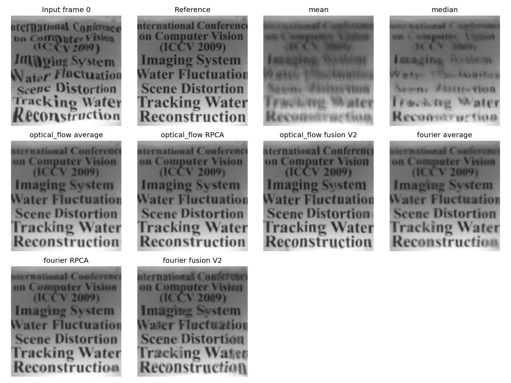
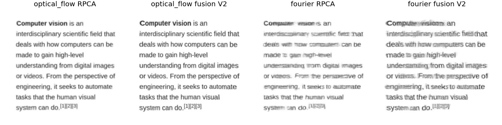
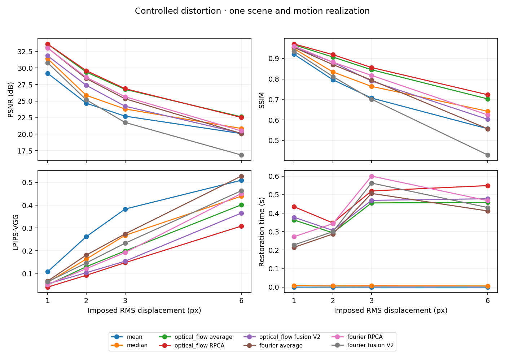

# Un-Rippling
## Recovering scenes seen through wavy water without deep learning

Digital Image Processing course project

### Abstract

A moving water surface displaces different parts of a stationary scene by different amounts. We estimate that motion from multiple video frames and compare four reconstructions of the registered observations. On six public videos, sparse Fourier registration followed by robust PCA gave the highest mean PSNR (25.45 dB) and SSIM (0.8672) among eight prespecified methods. Optical-flow registration followed by lucky patch fusion gave the lowest mean VGG LPIPS (0.0941). Local patch selection can preserve sharp-looking edges while moving them away from their reference locations. A four-level synthetic experiment illustrates the loss of geometric information when few features remain trackable.

## 1. Introduction and objectives

A stationary poster photographed through still water provides a clean reference. Under waves, even a camera on a tripod records curved lines and moving letters. Averaging can suppress that motion at the cost of blur. The course objectives are to establish temporal baselines, compare dense and sparse registration, test whether local selection improves upon low-rank reconstruction, and identify a measurable failure case. The algorithms receive only the distorted observations. Clean references are used for assessment after reconstruction.

## 2. Model and related work

Let $J(x)$ denote the fixed intensity at reference coordinate $x$. We seek a displacement $f_t(x)$ such that $J(x)\approx I_t(x+f_t(x))$. This is a backward sampling map: the output grid supplies the query coordinates in the source frame. A single displacement cannot describe several rays from distinct scene points that arrive at the same pixel.

Farnebäck [1] estimates dense motion through local polynomial expansions. The two-stage design of Oreifej et al. [2] motivates registration followed by robust scene recovery. Principal component pursuit [3] separates correlated observations from sparse corruption. James et al. [4] use feature trajectories, spatiotemporal frequency sparsity and residual polynomial flow for refraction. Our implementation uses FISTA [5] for the sparse optimization. Our lucky patch method adapts earlier lucky-region selection [6] to registered stacks with validity and confidence.

## 3. Methodology

**Stage 1.** Compute the temporal mean and median along the time axis. Each produces one image. The median also initializes Stage 2.

**Stage 2.** Estimate dense flow from the current template to every original frame. Pull each original through that flow, clip interpolation overshoot and average in-bounds observations. Repeat with windows 31, 21, 15 and 11 pixels. All four rounds resample the original frame. The forward/backward cycle residual estimates local agreement of the motion directions. Large cycle errors lower confidence.

**Stage 3.** Stack vectorized registered images as columns of $D$. Solve

$$\min_{L,S}\|L\|_*+\lambda\|S\|_1,\qquad D=L+S.$$

IALM alternates singular-value shrinkage, entrywise soft thresholding and a multiplier update. Since the image has many more pixels than frames, the eigendecomposition of its small frame-by-frame Gram matrix suffices for the singular-value step. Invalid observations are imputed with the registration reference. The output is the mean of the low-rank columns.

**Stage 4.** At each overlapping 32-pixel square, compute Sobel energy and masked normalized correlation against the template. V1 ranks by sharpness, V2 adds similarity, and V3 adds a registration-specific confidence. Initial weights are 0.4/0.4/0.2 on the active terms. Rank only usable patches and take the best 10%. Blend them over a 16-pixel stride using the selected quality weights, pixel validity, and a positive interior Hann window. No score uses the ground truth. Bright reflections and strongly displaced edges can both score as sharp.

**Stage 5.** Track Shi–Tomasi corners by KLT, reject inconsistent matches, and estimate each reference location from the centroid of its surviving trajectory. Horizontal and vertical offsets on a coarse grid constrain a separate Fourier field per component. With $F$ a unitary 3D Fourier transform and $P$ selection of distinct observed cells, recover coefficients from

$$\min_{\theta}\tfrac12\|PF^{-1}\theta-b\|_2^2+\lambda\|\theta\|_1.$$

The adjoint scatters residuals at sampled cells and applies the forward FFT. Distinct rows of a unitary transform have unit operator norm, so a unit gradient step is valid. FISTA applies complex phase-preserving soft thresholding followed by momentum. The real inverse transform supplies a dense coarse-grid field, expanded to pixel coordinates. Independent half-track fits supply a sensitivity estimate for V3. Optional polynomial refinement estimates residual flow on the registered stack, composes the fields and samples the original frames.

**Data flow and eight methods.** Each of the two registration branches returns every registered frame and its averaged reconstruction. Each stack feeds both RPCA and fusion independently. Those four downstream images are the primary outputs. The two temporal outputs and two branch averages complete the eight-method comparison. V2 is frozen for this comparison.

## 4. Data, protocol and runtime

The six public CompressiveFlows videos are Checker and Cartoon and Eye (captured Real1), Middle and Small (captured Real2), and Vision (public simulation). Each has 101 native frames and a paired reference. We used the first 100 frames and a matching center-square resize to 256 × 256. Four additional 20-frame cases use one cameraman reference and one seed at four amplitudes. Those four related cases are analyzed separately. There are 680 input frame instances and 80 principal comparison outputs in total.

PSNR uses peak intensity one; SSIM uses scikit-image on grayscale; LPIPS uses pretrained VGG on replicated grayscale channels mapped to [−1,1]. The four-pixel border is excluded for all metrics. No output-specific alignment adjustment was applied. Timings use seconds per clip on a two-vCPU AMD EPYC Linux environment, with shared registration charged once for each downstream path. They exclude file I/O and LPIPS evaluation. GPU laptop results recorded in the development branch have different input and timing conventions.

## 5. Results

Mean across the six public clips:

| Method | PSNR (dB) ↑ | SSIM ↑ | LPIPS ↓ | Time (s) ↓ |
| --- | --- | --- | --- | --- |
| mean | 20.0376 | 0.5835 | 0.4647 | 0.0049 |
| median | 19.8185 | 0.6472 | 0.3722 | 0.1302 |
| Farnebäck average | 23.0641 | 0.8365 | 0.1178 | 6.2128 |
| Farnebäck RPCA | 23.0359 | 0.8406 | 0.1051 | 8.5536 |
| Farnebäck fusion V2 | 22.6007 | 0.8320 | 0.0941 | 6.4704 |
| Fourier average | 25.1787 | 0.8501 | 0.1493 | 9.0569 |
| Fourier RPCA | 25.4529 | 0.8672 | 0.1223 | 11.3792 |
| Fourier fusion V2 | 24.1833 | 0.8422 | 0.1227 | 9.3009 |

Middle's Fourier RPCA output preserves distinct strokes. Its 25.24 dB exceeds optical RPCA's 22.54 dB. Vision reverses that ranking, with 17.21 dB for Fourier RPCA and 19.95 dB for optical RPCA. Repeated letters and uneven feature coverage can make correspondence ambiguous; this experiment does not identify a unique cause.

### 5.1 Fusion ablations

| Method | PSNR (dB) ↑ | SSIM ↑ | LPIPS ↓ | Time (s) ↓ |
| --- | --- | --- | --- | --- |
| Farnebäck fusion V1 | 22.5476 | 0.8285 | 0.0971 | 6.4594 |
| Farnebäck fusion V2 | 22.6007 | 0.8320 | 0.0941 | 6.4704 |
| Farnebäck fusion V3 | 22.6171 | 0.8339 | 0.0921 | 6.4995 |
| Fourier fusion V1 | 23.6687 | 0.8242 | 0.1364 | 9.2993 |
| Fourier fusion V2 | 24.1833 | 0.8422 | 0.1227 | 9.3009 |
| Fourier fusion V3 | 24.4301 | 0.8487 | 0.1165 | 9.3613 |

V3 beats V2 in LPIPS on all 12 public branch–clip pairs, in PSNR on 10/12 and in SSIM on 11/12. The exceptions in PSNR are Eye with optical flow and Cartoon with Fourier registration. V3 is a reasonable development choice when confidence is available and perceptual similarity is the priority. Keep V2 as the reproducible course comparison default: it applies to both unrefined and refined stacks and to clips with sparse support. All V2 and V3 scores come from the same per-branch stack. Refined Fourier lacks an independently estimated confidence map.

### 5.2 Refinement and runtime

| Method | PSNR (dB) ↑ | SSIM ↑ | LPIPS ↓ | Time (s) ↓ |
| --- | --- | --- | --- | --- |
| Fourier average | 26.1929 | 0.8966 | 0.0953 | 5.6081 |
| Fourier RPCA | 26.3005 | 0.9038 | 0.0863 | 7.8787 |
| Fourier fusion V2 | 25.7118 | 0.8965 | 0.0807 | 5.8739 |

These runs apply the same residual polynomial-flow option to all six public inputs. Against the corresponding unrefined Fourier result, PSNR increases for all 18 pairs and LPIPS decreases for all 18. The RPCA SSIM on Checker falls slightly. Refined V2 gains 2.81 dB on Middle and 1.37 dB on Vision. The unrefined timed registration includes split-track fits for V3; refined timing omits those fits. Comparing their total seconds does not isolate the cost of the refinement itself. [Individual refinement scores](../comparison/results/course/refinement.csv)

### 5.3 Controlled severity and failure

The labels low, medium, high and extreme correspond to 1, 2, 3 and 6 px RMS. Each clip uses 20 frames at 128 square, NumPy seed 0, independent Gaussian fields smoothed at sigma 8 px, temporal mean removed, scaled to the target RMS. Frames sample the clean cameraman image at grid plus the imposed displacement. These labels are internal and have no calibration to MFIR amplitudes.

| method | 1 px | 2 px | 3 px | 6 px |
| --- | --- | --- | --- | --- |
| Fourier RPCA | 33.0369 | 28.5971 | 25.6681 | 20.4997 |
| Fourier average | 33.0605 | 28.4203 | 25.3567 | 20.1049 |
| Fourier fusion V2 | 30.8163 | 25.1985 | 21.7763 | 16.8538 |
| mean | 29.2203 | 24.6824 | 22.7302 | 20.0948 |
| median | 31.4400 | 25.8719 | 23.8148 | 20.8689 |
| Farnebäck RPCA | 33.6469 | 29.6072 | 26.8860 | 22.5442 |
| Farnebäck average | 33.6421 | 29.3974 | 26.7822 | 22.6355 |
| Farnebäck fusion V2 | 31.8604 | 27.3928 | 24.2309 | 20.1403 |

At 6 px only six tracks survive. Both Fourier coordinates reach the 500-iteration cap and the stationarity residuals exceed 1e−4. Fourier V3 is unavailable because fewer than eight tracks cannot form two usable halves. V2 Fourier fusion falls to 16.85 dB, below the temporal mean at 20.09 dB. All eight primary rows remain available. The full CSV includes every observed PSNR, SSIM, VGG LPIPS and time. [All measurements](../comparison/results/course/combined.csv)

## 6. Limitations and conclusion

The capture study includes five real videos. Ground truth is a supplied reference, and alignment uncertainty on the order of a pixel affects fine score differences. The controlled sweep shares one scene and seed. Optical and Fourier confidence can agree on a systematically wrong match. At high distortion, temporal averaging and low-rank estimation suppress ghost edges, while local selection can preserve them. The results favor Fourier RPCA for mean pixel fidelity and optical fusion for perceptual similarity under this protocol. A separate held-out MFIR comparison would require the prescribed RGB inputs, official subset and metric conventions. No physical tray recording or full MFIR evaluation was performed in this project.

## References

1. G. Farnebäck. *Two-frame motion estimation based on polynomial expansion*. SCIA, 2003.
2. O. Oreifej et al. *A two-stage reconstruction approach for seeing through water*. CVPR, 2011.
3. E. Candès et al. *Robust principal component analysis?* Journal of the ACM, 2011. Z. Lin et al., *The augmented Lagrange multiplier method for exact recovery of corrupted low-rank matrices*, 2010.
4. J. G. James, P. Agrawal and A. Rajwade. *Restoration of non-rigidly distorted underwater images using a combination of compressive sensing and local polynomial image representations*. ICCV, 2019.
5. A. Beck and M. Teboulle. *A fast iterative shrinkage-thresholding algorithm for linear inverse problems*. SIAM Journal on Imaging Sciences, 2009.
6. M. Aubailly et al. *Automated video enhancement from a stream of atmospherically-distorted images: the lucky-region fusion approach*. SPIE, 2009.
7. R. Zhang et al. *The unreasonable effectiveness of deep features as a perceptual metric*. CVPR, 2018.
8. M. V. Shugaev et al. *A unified benchmark for multi-frame image restoration under severe refractive warping*. CVPR Workshops, 2026. [Data and code](https://zenodo.org/records/19390086).

[Detailed results and gallery](experiments.md) · [Algorithm details](pipeline.md) · [Data coverage](dataset_inventory.md)
